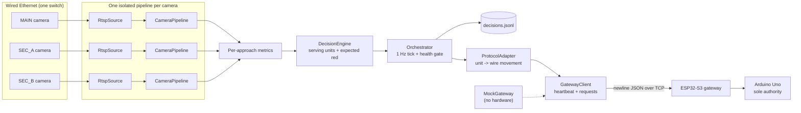

# Intelligent Traffic Control

[](https://www.python.org/)
[](https://opencv.org/)
[](https://www.ultralytics.com/)

The AI host for **Smarti**, a single T-junction traffic controller. Three
cameras watch `MAIN`, `SEC_A` and `SEC_B` over wired Ethernet; the host detects
and tracks vehicles, turns each approach into demand metrics, decides **which
serving unit deserves green next and for how long**, and sends that as an
**advisory** request to an ESP32-S3 gateway over Wi-Fi. The ESP32 and the
Arduino Uno remain the authority for phase order, yellow, all-red and the
lamps.

> **No part of this has been validated on hardware.** Verification is against
> recorded/synthetic video, the mock gateway and a hypothetical three-phase
> mock. See "Limitations".

## Architecture



Each camera has its own detector, tracker, road region, counter, congestion
window and polygon. Ultralytics' `persist=True` keeps ByteTrack state on the
model object, so a shared detector would mix track IDs between streams.
`tests/test_pipeline_isolation.py` proves the isolation.

## Serving units and modes

A **serving unit** is what the engine allocates green to: one or more
approaches. The engine never hard-codes an approach name or a wire movement.
The layout comes from `decision.units`, and the mapping to the wire is a
separate, pure adapter at the edge.

| Mode | Units | Wire movement | Current firmware |
| --- | --- | --- | --- |
| `compat_two_phase` (default) | `MAIN`, `SECONDARY` (`SEC_A`+`SEC_B`) | `MAIN`, `SECONDARY` | **yes** |
| `three_phase` (opt-in, disabled) | `MAIN`, `SEC_A`, `SEC_B` | `MAIN`, `SECONDARY_A`, `SECONDARY_B` (**proposed**) | **no** |

The current Uno drives two approaches, so a three-approach T junction **cannot
be fully controlled yet**. The default is a workaround: `SEC_A` and `SEC_B`
share one `SECONDARY` request, and the Uno cannot tell them apart. Three-phase
mode refuses to start unless it is enabled explicitly **and** the movement
names are written out; it then logs a prominent warning. The proposed firmware
design is in [`docs/FIRMWARE_THREE_PHASE_PROPOSAL.md`](docs/FIRMWARE_THREE_PHASE_PROPOSAL.md)
and is **not implemented**.

**Assumption: exactly one approach is green at a time.** Phase order and
clearance belong to the Uno. The host never sends red, yellow or an order.

## Safety model

- **Advisory only.** A request is stored by the Uno as *pending* and applied at
  the next phase entry. The host never claims a phase or lamp changed; at most
  the log records that the controller *accepted* a request.
- **No emergency priority.** `priority` is always `"NORMAL"`; there is no
  emergency code path.
- **Fail safe.** If an approach is unhealthy (camera not `LIVE`, metrics older
  than 2 s, or a stalled pipeline), the engine makes no recommendation and the
  heartbeat gate closes. The gateway expires the link and the Uno runs its
  autonomous cycle. Missing data is never treated as zero traffic, and a merged
  unit is never scored from a subset of its members.
- **No flooding.** One request in flight, 2 s reply timeout, 8 s minimum
  interval, and requests only on a material change.
- **Red is a model, not a message.** The host estimates expected red for
  fairness and logging. There is no red-duration or phase-order field.

## Installation

Python 3.10+ on Windows or Linux.

```bash
python -m venv .venv
# Windows: .venv\Scripts\activate
# Linux/macOS: source .venv/bin/activate
pip install -r requirements.txt
```

The first run downloads `yolo11n.pt` through Ultralytics. All tests run on CPU.

## Quick start without hardware

1. Copy the example config and point the cameras at video files:

   ```bash
   cp config.example.yaml config.yaml
   ```

   Replace the three RTSP camera entries with file sources, for example:

   ```yaml
   cameras:
     - id: cam_main
       approach: MAIN
       source: file
       path: samples/main.avi
       loop: true
       realtime: true
       target_fps: 8
   ```

   Keep the compat `decision.units` layout and `health.required_cameras: 3`.

2. Start the mock gateway in one terminal:

   ```bash
   python -m gateway.mock_gateway
   ```

   It prints `{"mock_gateway": "listening", ...}`. Useful flags:
   `--nack-rate 0.1`, `--timeout-rate 0.1`, `--seed 3`,
   `--heartbeat-freshness 3.0`.

3. Run the host in another terminal:

   ```bash
   python main.py --config config.yaml --mock-gateway
   ```

   Decisions are appended to `logs/decisions.jsonl`. Add `--display` to see the
   annotated tiles, or `--dry-run` to run without any gateway at all.

### Trying the hypothetical three-phase path

For host-side testing only, against firmware that does not exist:

```bash
python -m gateway.mock_gateway --movements MAIN,SECONDARY_A,SECONDARY_B
```

Use the three-unit layout and `gateway.mode: three_phase` with
`three_phase.enabled: true` and explicit movements (see
`config.example.yaml`, commented). The mock flag is labelled hypothetical; the
real gateway rejects these names today.

## Legacy single-camera demo

The original visual demo still works, without a config file or gateway:

```bash
python main.py --source webcam:0
python main.py --source file:samples/clip.avi
```

It opens the annotated window (IDs, movement, counting line, road region,
counts, congestion) and exits on `q`.

## Running with real cameras and the ESP32

1. Network the cameras and laptop as described in
   [`docs/NETWORKING.md`](docs/NETWORKING.md): camera subnet `192.168.50.0/24`,
   which must not overlap the ESP32 SoftAP `192.168.4.0/24`. Join the laptop to
   `Smarti-Gateway` over Wi-Fi for the gateway link.
2. Export credentials (never commit them):

   ```bash
   export CAM_USER=admin
   export CAM_PASS=...
   ```

3. Edit `config.yaml`: three RTSP URLs (use each camera's **sub-stream**, 720p,
   H.264, 5–15 fps), per-camera polygon and counting line if needed, and the
   compat unit layout.
4. Run:

   ```bash
   python main.py --config config.yaml
   ```

5. Verify the link: `logs/decisions.jsonl` should show `"health_gate_open": true`
   and accepted requests. If the gate stays closed, the log names the unhealthy
   approach or the missing fresh camera. The full first-session checklist is
   [`docs/BENCH_TEST_PLAN.md`](docs/BENCH_TEST_PLAN.md) — none of it has been
   performed.

## Configuration

`config.example.yaml` is the reference; `config.yaml` is ignored by git.
`${VAR}` placeholders are expanded from the environment, and a missing variable
is a startup error. Relative file paths are resolved against the config file.

| Section | Purpose |
| --- | --- |
| `cameras` | `id`, `approach`, `source` (`rtsp`/`webcam`/`file`), `url`/`index`/`path`, `flip`, `target_fps`, normalized `polygon`, `count_line`, `width`/`height`, `stale_after_s`. |
| `decision.units` | Serving layout: `{id, approaches}` entries. Compat: `MAIN` + `SECONDARY`; three-phase: `MAIN`, `SEC_A`, `SEC_B`. |
| `decision` | Weights, `base_green_s`, `k_green_s`, `score_saturation`, green min/max (inside 5–30), `min_delta_s`, `min_interval_s`, starvation and smoothing windows, `aggregation: sum|max`, `yellow_s`, `all_red_s`, `max_red_s`, `green_memory_s`, health policy. |
| `gateway` | `mode`, host, port, connect/handshake/request timeouts, heartbeat interval, reconnect bounds, request backoff; optional `three_phase: {enabled, movements}`. |
| `health` | Frame freshness, tick interval, tick timeout, `required_cameras` (`null` = all). |
| `detection` | Model path, `device: auto|cuda|cpu`, confidence, optional `imgsz`. |
| `performance` | `profile: auto|low|balanced|high`, optional target fps, model size, preview fps/scale, thread caps, `adaptive_fps`, `min_fps`. Auto resolves to low on <= 8.5 GB. |
| `logging` | Console level, JSONL path, rotation size and backup count. |
| `display` | Default for the annotated window. |

### Decision parameters

```text
score = w_queue * vehicles_in_region
      + w_stationary * stationary_count
      + w_wait * max_wait_s
      + w_congestion * congestion_weight     # Low 0, Moderate 1, High 2
green = clamp(round(base + k * min(1, score / score_saturation)), 5, 30)
```

Metrics are smoothed over `smoothing_window_s`; a unit with demand that has
waited longer than `max_wait_before_force_s`, or whose **estimated red** exceeds
its `max_red_s`, is forced to the top. Expected red is derived from the other
units' greens plus one yellow/all-red clearance for each:

```text
expected_red(unit) = sum(expected_green(other units))
                   + (number of other units) * (yellow_s + all_red_s)
```

`base_green_s` is the default expected green for a unit with no recent
recommendation. All weights, thresholds, yellow (3 s), all-red (1 s) and
`max_red_s` (90 s) are **starting values to be tuned**, not calibrated
constants. See [`docs/DECISION.md`](docs/DECISION.md).

## Gateway protocol

UTF-8 JSON, one compact object per line (`\n`), maximum 512 bytes per line. The
reader buffers until newline and survives split or merged TCP chunks; oversized
lines are discarded to the next newline.

| Direction | Message | Reply |
| --- | --- | --- |
| Host → gateway | `{"type":"HEARTBEAT"}` | `{"type":"GATEWAY_ACK","status":"HEARTBEAT_OK"}` |
| Host → gateway | `{"type":"STATUS_REQUEST"}` | `{"type":"UNO_STATUS","detail":"STATUS:..."}` |
| Host → gateway | `{"type":"TRAFFIC_REQUEST","movement":"SECONDARY","green_time":15,"priority":"NORMAL","sequence":104}` | `{"type":"GATEWAY_ACK","status":"CONTROLLER_ACCEPTED","sequence":104,"uno_ack":"ACK:REQUEST_SIDE,15"}` |

`movement` is `MAIN`/`SECONDARY` in compat mode. `SECONDARY_A`/`SECONDARY_B` are
proposals that only a hypothetical gateway (or the mock started with
`--movements`) accepts. Rejections are `{"type":"ERROR","reason":"..."}` with
`AI_LINK_OFFLINE`, `INVALID_FIELDS`, `OUT_OF_POLICY`, `STALE_SEQUENCE`,
`UNO_ACK_TIMEOUT` or `UNO_NACK`. A new TCP session starts without a valid
heartbeat and with the sequence reset; the client handshakes with a heartbeat,
then starts at 1. Heartbeats are sent every second only while the decision loop
has ticked within 2 s and the required cameras are fresh; a traffic request
does not refresh freshness.

## Decision log

One JSON object per tick in `logs/decisions.jsonl`, rotated by size:

- `ts`, `monotonic_s`, `mode`
- `health_gate_open`
- `cameras`: state, fps, frame age, reconnect count
- `approaches`: the full `ApproachMetrics` snapshot per approach, always
- `units`: approaches, score, `expected_red_s` per unit
- `decision`: healthy, emitted, `unit_scores`, `expected_red_s`, reasons
- `recommendation`: `unit_id`, `wire_movement`, green time, priority, reasons,
  scores, `expected_red_s`
- `request`: sent flag, unit, movement, green time, sequence, accepted, status,
  latency, raw gateway reply

Cycles that emit nothing are logged too, which is what makes comparison with a
fixed-time baseline possible later. Note for log consumers: the old
`decision.group_scores` key is now `decision.unit_scores`, and
`recommendation.movement` is now `unit_id` plus `wire_movement`. Per-approach
metrics and the request fields keep their names.

## Operator console (optional)

The PySide6 console is a separate layer. The core never imports it, and
without `--gui` nothing changes. PySide6 is the only added dependency.

```bash
python main.py --config config.yaml --gui                 # real gateway
python main.py --config config.yaml --gui --mock-gateway  # mock gateway
python main.py --config config.yaml --gui --dry-run       # no gateway at all
```

Start the mock gateway first when using `--mock-gateway`:

```bash
python -m gateway.mock_gateway
```

Press **START** in the bottom bar (or F5). The console shows the three live
annotated tiles, the advisory T-junction schematic, system state, live events,
the log and the decision table. A single always-visible menu-bar badge names
the mode: `SIMULATION:DRY-RUN`, `SIMULATION:MOCK-GATEWAY`,
`SIMULATION:THREE-PHASE`, `SIMULATION:FILE-SOURCES` or `LIVE:COMPAT-2PH`.

| Control | Behaviour |
| --- | --- |
| Start / Stop (F5) | Start or stop pipelines and the decision loop. Stop confirms. |
| Hold / Resume requests (Ctrl+H) | Keep analysing and heartbeating but send no `TRAFFIC_REQUEST`s; decisions are logged with `reason: operator_hold`. |
| Reset analysis (Ctrl+R) | Confirm; clears smoothing, counters and tracks, and restarts the gateway session (sequence back to 1). |
| Release to autonomous (Ctrl+L) | Confirm; closes the heartbeat gate so the controller runs its own cycle. Resume control restores normal gating. |
| Save / Export log (Ctrl+E) | Save-as for JSONL, flattened CSV or the filtered log text; range last 5 min, last hour, all decisions or selected rows. Runs in a worker with progress and a Show-in-folder result. |
| Export diagnostics (Ctrl+Shift+E) | Zip with redacted config, versions, logs, decisions and camera health. Never images. |
| Save dashboard image (Ctrl+Shift+S) | Explicit click only, with one privacy warning. |
| Shutdown (Ctrl+Q) | Confirm; stops requests and heartbeats, flushes logs, joins threads and closes. |
| Open logs folder / View configuration / About | Convenience; the config view is read-only and redacted. |

The console is advisory: it shows the last recommendation, the controller's
reply and derived expected red. It never draws a lamp as physical state. Tile
context menus add polygon/line toggles, flip and snapshot. Focus mode (F11)
shows one large camera and two small ones; no tile opens a second window.
View > Video preview can be turned off (logs and decisions keep updating),
and Preview quality selects 4/8/12 fps. Light theme and reduced motion are in
Settings and persist with the window layout.

Representative screenshots (synthetic video, mock gateway, offscreen renders)
are in [`docs/ui/after/`](docs/ui/after/). No real camera or controller was used
for them. The measured fix pass and benchmark method are documented in
[`docs/GUI_FIXES.md`](docs/GUI_FIXES.md) and
[`docs/PERFORMANCE.md`](docs/PERFORMANCE.md).

## Tests

```bash
pytest
```

No GPU, camera, or network is required. Coverage includes framing edge cases
and field validation, handshake/reconnect/sequence reset, heartbeat gating,
every gateway error reply, camera manager lifecycle and stale detection,
per-camera pipeline isolation, decision rules (scoring, smoothing, starvation,
hysteresis, clamping, degraded cameras, expected red, `max_red_s`), generic
two- and three-unit layouts, aggregation, unit→movement adapter output and mode
refusals, config validation, log rotation, and end-to-end runs of three looping
videos through decisions to the mock gateway in **both** modes.

## Project structure

```text
Intelligent_Traffic_Control/
├── app/
│   ├── config.py           # typed YAML + units/mode validation
│   ├── decision_log.py     # size-rotated JSONL
│   └── orchestrator.py     # tick, health gate, log, display
├── analytics/              # congestion, road region, counter
├── camera/                 # webcam/RTSP/file sources and manager
├── decision/
│   ├── engine.py           # generic unit scoring, expected red, fairness
│   ├── models.py           # ServingUnit, ApproachMetrics, Recommendation
│   └── settings.py         # tunables
├── detection/              # YOLO + ByteTrack, one per camera
├── gateway/
│   ├── adapter.py          # unit -> wire movement, modes
│   ├── client.py           # threaded reconnecting client
│   ├── mock_gateway.py     # hardware-free gateway
│   └── protocol.py         # framing + validation
├── pipeline/               # per-camera perception worker
├── tests/
├── docs/                   # decision, networking, audit, proposals, bench plan
├── config.example.yaml
├── main.py
└── requirements.txt
```

## Limitations and open items

- **The T junction cannot be fully controlled yet.** Current firmware accepts
  only `MAIN`/`SECONDARY`, so the default compat mode merges `SEC_A` and
  `SEC_B`; the Uno cannot tell them apart. Three-phase control needs the
  firmware work in the proposal document.
- **Three-phase movement names are unconfirmed proposals.** `SECONDARY_A` and
  `SECONDARY_B` exist only in config, the adapter and the hypothetical mock.
- **Yellow, all-red and `max_red_s` are placeholders.** 3 s / 1 s / 90 s match
  the README, not verified firmware timings.
- **One approach green at a time is an assumption.** Simultaneous movements are
  out of scope and would need a different model.
- **Nothing was validated on hardware.** No cameras, ESP32, Uno, lamps,
  networking or display have been exercised. The bench plan is unperformed.
- Decision weights and thresholds are untuned and need real footage.
- Accuracy depends on lighting, camera angle, occlusion and shadows.
- There is no license file and no CI configuration.
